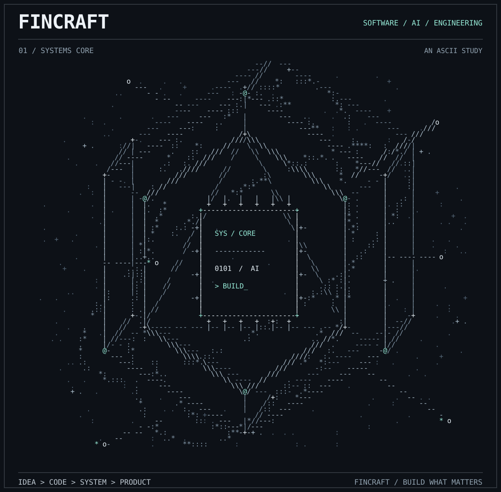

  

  <strong>From idea to code. From code to product.</strong>

  <a href="https://wavern.com.br/">Wavern</a> &nbsp;·&nbsp;
  <a href="#inside-the-workshop">Inside the workshop</a>

### Inside the workshop

We're Fincraft, a software company building products and exploring what's possible with engineering and AI. This is our workspace for things we're developing, testing, and sharing as they take shape.

- **Products** — software and digital experiences built around real needs.
- **Engineering** — services, platforms, APIs, and the foundations behind them.
- **Intelligence** — practical experiments with AI and automation.
- **Lab** — ideas, prototypes, and works in progress.

**Featured product:** [Wavern](https://wavern.com.br/) — an accounting and fiscal platform developed by Fincraft.

Some projects are experiments or works in progress. Each repository has its own documentation and license, where applicable.
