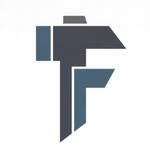

<p align="center">
  
</p>

<h3 align="center">From idea to code. From code to product.</h3>

<p align="center">
  <a href="https://wavern.com.br/">Wavern</a> &nbsp;·&nbsp;
  <a href="#what-were-building">What we're building</a>
</p>

### About Fincraft

Fincraft is the software company behind [Wavern](https://wavern.com.br/). We build software, explore AI, and turn ideas into products. This is where we share some of the projects we're working on.

### What we're building

- Software products and developer tools
- APIs, integrations, and infrastructure
- AI experiments and automation
- Prototypes and projects still taking shape

**Wavern:** an accounting and tax platform built by Fincraft.

<sub>Some repositories contain early experiments. See each project for its status and documentation.</sub>

<!-- fincraft-projects:start -->

## Aberto para inspeção

```text
   ___  __________
  |   ||   _____ /   FINCRAFT
  |___||  |____/    OPEN LAB
       |  |
       |__|
```

Este catálogo reúne quatro projetos independentes. Todos começam com exemplos fictícios e explicam o que ainda precisa ser confirmado antes de um uso operacional.

| Projeto | Pergunta que ele ajuda a responder | Experimente |
| --- | --- | --- |
| [Dona Norma](https://github.com/fincraft-solutions/dona-norma) | Que fonte sustenta esta orientação tributária? | `npm run verificar-base` |
| [Em Dia](https://github.com/fincraft-solutions/em-dia) | Quais pendências entram na fila de acompanhamento? | `npm run rodar -- exemplos/carteira.json --sem-ia --hoje 2026-10-24` |
| [Pente-Fino](https://github.com/fincraft-solutions/pente-fino) | Qual regra levantou esta hipótese de divergência? | `npm run diagnosticar -- exemplos/simples-comercio.json` |
| [Wavern Skills](https://github.com/fincraft-solutions/wavern-skills) | Que evidências faltam em uma investigação? | `npx skills@latest add fincraft-solutions/wavern-skills` |



**Leia antes de usar:** os exemplos são sintéticos; status e documentação estão em cada repositório. Para bugs e novos casos, abra issues sem dados reais de clientes.

<!-- fincraft-projects:end -->
